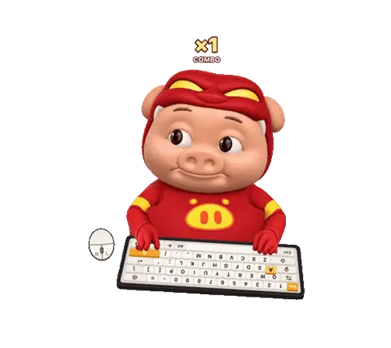

# GGBond Pet

A transparent typing and mouse companion featuring GG Bond, based on **[qianyiai/kurocat](https://github.com/qianyiai/kurocat) 4.7.0**. Independently maintained, unofficial fan project.

[中文](README.md) · [Downloads](https://github.com/newsun-boki/GGBond_Pet/releases/latest) · [Attribution](NOTICE.md) · [Asset terms](ASSET_LICENSE.md)



Hands travel to actual key positions using interruptible curves, two-bone IK and PNG mesh deformation. The body follows a damped spring. One hand can grip the mouse while the other types. Combos at 10/30/60/100 trigger expressions, a lollipop and celebrations. KuroCat's keyboard, mouse, layouts, privacy detection, tray and existing characters are retained.

## Install

Download packages and `SHA256SUMS.txt` from [Releases](https://github.com/newsun-boki/GGBond_Pet/releases/latest). No Node.js or Rust installation is needed to run them.

- **macOS:** Universal DMG/ZIP contains Apple Silicon and Intel. Drag `KuroCat-GGBond.app` to Applications and enable Accessibility/Input Monitoring. Keep “始终置顶显示” enabled for fullscreen overlays. Packages are ad-hoc signed, not notarized; use [Apple's per-app approval](https://support.apple.com/102445) if blocked.
- **Windows 10/11 x64:** NSIS installer or portable ZIP; WebView2 Runtime required. Packages are unsigned.
- **Linux amd64/arm64:** DEB/AppImage built on Ubuntu 22.04. Prefer X11; Wayland capture and distribution-specific dependencies need further testing.
- **Browser:** Download `GGBond-Pet-preview.html` and open it locally; it receives input only from that page.

Apple Silicon macOS 14 has been exercised locally, including two native fullscreen/desktop cycles. Intel, Windows and Linux packages are build-validated, not hardware-tested. Minimum deployment targets (Intel macOS 10.15 / ARM64 11) do not imply testing on those OS versions. Windows 7 is not promised.

## Development

Node.js 22+, Rust 1.100.0 and [Tauri prerequisites](https://v2.tauri.app/start/prerequisites/) are required.

```sh
npm ci
npm run test:motion
npm run build
npm run tauri:dev
```

Build packages with `npm run tauri -- build --bundles app` on Mac, `--bundles nsis` on Windows, or `--bundles deb,appimage` on Linux. `npm run build:preview` produces a self-contained HTML. See [development notes](docs/DEVELOPMENT.md).

## Privacy and licensing

This fork adds no input-text logging or telemetry. Key bubbles display key names and can be disabled. Inherited password detection does not cover every application. MCP defaults to disabled; keep it loopback-only if enabled. Automatic installation of upstream updates is disabled.

Code is MIT-licensed with KuroCat attribution retained. BigFish sprite terms remain alongside the assets and in packages. GG Bond names, likenesses and trademarks belong to their respective rightsholders; this project grants no such rights. Fan artwork is excluded from the root code license. See [NOTICE.md](NOTICE.md) and [ASSET_LICENSE.md](ASSET_LICENSE.md).
