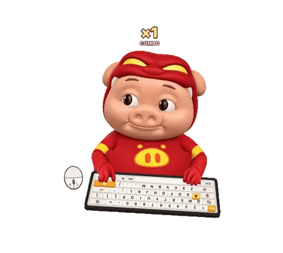

# 🐷 GGBond Pet · 猪猪侠桌宠

[](https://github.com/newsun-boki/GGBond_Pet/releases/latest)
[](https://github.com/newsun-boki/GGBond_Pet/actions/workflows/ci.yml)
[](LICENSE)

敲键盘时，猪猪侠会抬手移到对应的键位；移动鼠标时，手掌和身体一起跟随。连续打字还能触发表情、棒棒糖和庆祝动作。

**本项目基于 [qianyiai/kurocat](https://github.com/qianyiai/kurocat) 4.7.0 二次开发**，尤其参考“大肥鱼”的分层角色设计。感谢 KuroCat 原作者与贡献者提供桌面框架、输入监听、键鼠与角色系统。完整来源见 [NOTICE.md](NOTICE.md)。这是独立维护的非官方同人桌宠。

[English](README.en.md) · [下载安装](https://github.com/newsun-boki/GGBond_Pet/releases/latest) · [安装排错](docs/INSTALL.md) · [开发说明](docs/DEVELOPMENT.md) · [反馈](https://github.com/newsun-boki/GGBond_Pet/issues)

<p align="center"></p>

## 下载与适配

从 [Releases](https://github.com/newsun-boki/GGBond_Pet/releases/latest) 下载，并用同一 Release 的 `SHA256SUMS.txt` 校验。**运行安装包不需要 Node.js 或 Rust。**

| 平台 | 安装包 | 支持与验证范围 |
| --- | --- | --- |
| macOS Apple Silicon / Intel | [Universal DMG](https://github.com/newsun-boki/GGBond_Pet/releases/download/v1.0.0/GGBond-Pet-v1.0.0-macos-universal.dmg) · [APP ZIP](https://github.com/newsun-boki/GGBond_Pet/releases/download/v1.0.0/GGBond-Pet-v1.0.0-macos-universal.zip) | 双架构；Apple Silicon macOS 14 已实机验证，Intel 为编译验证；部署目标 Intel 10.15 / ARM64 11，最低系统未实机验证 |
| Windows 10/11 x64 | [安装 EXE](https://github.com/newsun-boki/GGBond_Pet/releases/download/v1.0.0/GGBond-Pet-v1.0.0-windows-x64-setup.exe) · [便携 ZIP](https://github.com/newsun-boki/GGBond_Pet/releases/download/v1.0.0/GGBond-Pet-v1.0.0-windows-x64-portable.zip) | CI 构建，需要 WebView2；尚未实机验收 |
| Linux x86_64 | [DEB](https://github.com/newsun-boki/GGBond_Pet/releases/download/v1.0.0/GGBond-Pet-v1.0.0-linux-amd64.deb) · [AppImage](https://github.com/newsun-boki/GGBond_Pet/releases/download/v1.0.0/GGBond-Pet-v1.0.0-linux-amd64.AppImage) | Ubuntu 22.04 构建基线，X11 优先；尚未实机验收 |
| Linux ARM64 | [DEB](https://github.com/newsun-boki/GGBond_Pet/releases/download/v1.0.0/GGBond-Pet-v1.0.0-linux-arm64.deb) · [AppImage](https://github.com/newsun-boki/GGBond_Pet/releases/download/v1.0.0/GGBond-Pet-v1.0.0-linux-arm64.AppImage) | 原生 ARM64 构建，需满足发行版依赖；尚未实机验收 |
| 浏览器 | [离线预览 HTML](https://github.com/newsun-boki/GGBond_Pet/releases/download/v1.0.0/GGBond-Pet-preview.html) | 下载后双击，只接收该网页输入，不需要桌面监听权限 |

以 Release 实际生成的附件为准。Windows 7 专用运行库、移动端、Wayland 无权限全局监听不在本次发布承诺内。Kylin/UOS 等发行版的 WebKitGTK、glibc、桌面环境不同，不能凭编译成功认定全部兼容。

## 快速安装

**macOS**：打开 DMG，把 `KuroCat-GGBond.app` 拖入“应用程序”再启动。保留这个应用名称以衔接早期试玩版。在“系统设置 → 隐私与安全性”开启此应用的“辅助功能”和“输入监控”，以接收其他窗口的输入。右键保持“始终置顶显示”开启，可跟随普通桌面和其他应用的全屏空间。

Mac 包使用临时签名，尚无 Apple Developer ID 公证。若系统阻止打开，先核对来源与校验值，再按 [Apple 官方说明](https://support.apple.com/102445) 在“隐私与安全性”对这个应用选择“仍要打开”；不需要全局关闭 Gatekeeper。

**Windows**：运行安装 EXE，或解压便携 ZIP 并启动 `KuroCat.exe`。缺少运行库时安装 [Microsoft WebView2 Evergreen](https://developer.microsoft.com/microsoft-edge/webview2/)。默认普通用户权限运行，发布包尚无商业签名。

**Linux**：使用 `sudo apt install ./GGBond-Pet-v1.0.0-linux-amd64.deb` 安装对应架构的 DEB；AppImage 添加执行权限后运行。详见 [安装说明](docs/INSTALL.md)。

## 交互功能

- **手到键上**：使用真实投影坐标，抬手跨过键帽后落键；快速换键可打断当前轨迹。
- **连续双臂**：两段 IK 计算肘部，PNG 网格连续变形，身体用阻尼弹簧跟随。
- **同时键鼠**：握鼠时另一只手继续打字，左右点击分别影响指尖，原生鼠标保留按下与滚轮反馈。
- **连击**：×10 笑脸、×30 墨镜、×60 棒棒糖、×100 双手庆祝；操作中的手优先完成输入。空闲超过 2.5 秒断连，长按重复与 Ctrl/Alt/Meta 快捷键不刷连击。
- **键盘**：65% / 108 键，面向角色或观众，气泡可关闭；面向角色时，观众看到反向字母属于正常方向。
- **桌面**：透明、置顶、20%–150% 缩放、拖动、鼠标穿透、Alt 临时解锁。
- **原有角色**：保留 KuroCat 的猫咪和大肥鱼，在右键菜单或托盘切换。

## 隐私与设置

键鼠事件用于本地动画，本项目不添加文本记录或遥测。按键气泡会在画面上显示键名，直播/录屏时可关闭。继承上游密码检测：识别到受支持的密码输入状态时隐藏键位、清空连击；不同应用的密码框识别能力并不一致。

MCP 默认关闭，手动开启后沿用上游本机回环接口；不要代理到公网。自动安装更新已停用，更新统一从本仓库 Releases 手动下载，避免装回上游版本。

配置路径：macOS `~/Library/Application Support/kurocat-ggbond/`；Windows `%APPDATA%\kurocat-ggbond\`；Linux `~/.config/kurocat-ggbond/`。自启动项和 Windows 快捷方式也与上游隔离。

## 源码运行

准备 Node.js 22+、Rust 1.100.0 与 [Tauri 平台依赖](https://v2.tauri.app/start/prerequisites/)。

```sh
git clone https://github.com/newsun-boki/GGBond_Pet.git
cd GGBond_Pet
npm ci
npm run tauri:dev
```

网页预览：`npm run dev`，打开 `http://localhost:1420/ggbond-preview.html`。单文件预览：`npm run build:preview`。完整构建和角色接入见 [开发说明](docs/DEVELOPMENT.md)。这是 Canvas 2D 角色扩展，不能作为普通 JSON 换色皮肤导入未经修改的 KuroCat，也不是 Live2D 模型包。

## 验证与限制

- 65%/108 键、两个方向共 340 项键位回放通过，覆盖换键、长按、快捷键、同时键鼠、连击、隐私和旧角色切换。
- Apple Silicon macOS 14 已验证透明窗口与两轮进入/退出全屏的可见性、层级。
- CI 编译不等于真人交互验收；最低系统、Intel、Windows、各 Linux 环境仍需更多实测。
- 单视角 2D 美术在极端手臂角度会拉伸；无完整三维转身、面捕或 Live2D 编辑工程。
- 独占全屏游戏、反作弊环境与多显示器组合不保证全部兼容。

## 版权与致谢

代码按 [MIT](LICENSE) 开源，保留 **Copyright (c) 2026 KuroCat Contributors**。感谢 [KuroCat](https://github.com/qianyiai/kurocat)、[dsh-pet](https://github.com/PC2005-cloud/dsh-pet) 和 [dsh-dafeiyu](https://github.com/QCYTSN/dsh-dafeiyu)。固定上游提交与修改范围见 [NOTICE.md](NOTICE.md)。

**代码许可不包含猪猪侠角色 IP 授权。** 贴图是 AI 辅助制作的非官方同人素材，非官方模型；角色形象、名称与商标归各自权利人所有，素材许可范围见 [ASSET_LICENSE.md](ASSET_LICENSE.md)。
